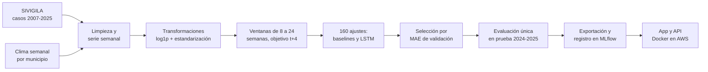
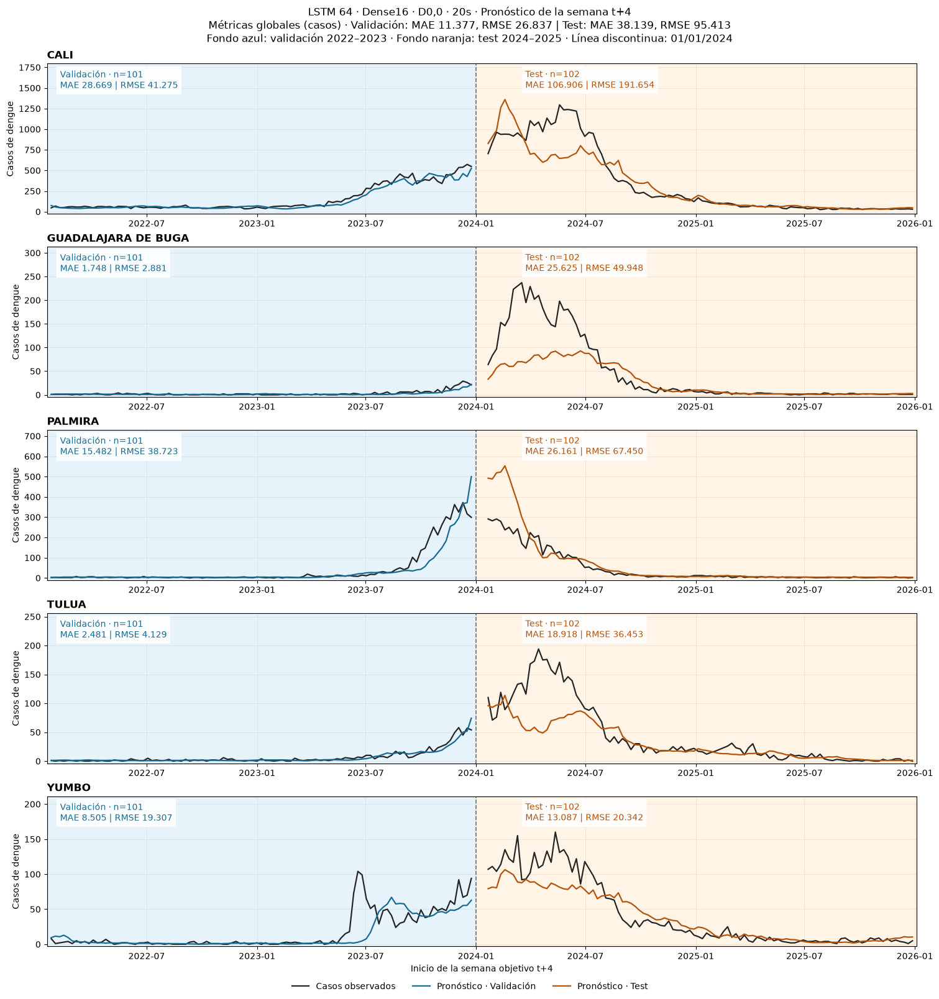
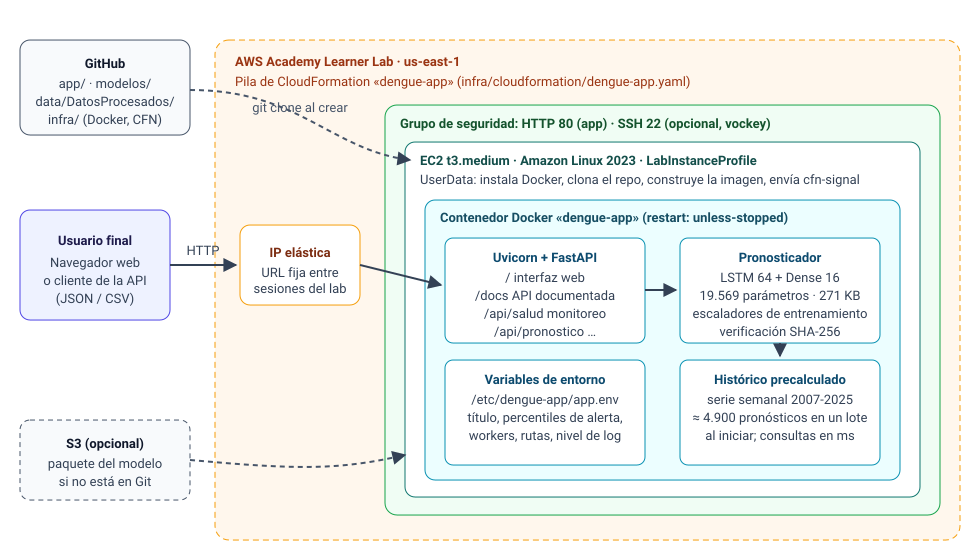

# Pronóstico semanal de dengue en el Valle del Cauca

Proyecto de grado · **Maestría en Inteligencia Artificial, Universidad de los Andes** · *Proyecto: Despliegue de Soluciones*

Construimos y desplegamos un sistema que pronostica los **casos de dengue de la semana t+4** (cuatro semanas adelante) en los cinco municipios del Valle del Cauca con más casos: Cali, Guadalajara de Buga, Palmira, Tuluá y Yumbo. Unimos 19 años de notificaciones del SIVIGILA con clima semanal por municipio y comparamos 160 ajustes de modelos, desde regresión lineal hasta redes LSTM globales y locales. Elegimos, por menor error de validación, una **LSTM global de 64 unidades que usa 20 semanas de historia** (MAE de 11,4 casos en validación). Ese modelo quedó desplegado en AWS como una aplicación web para usuarios no técnicos, con una API documentada y un servidor MLflow que reúne la comparación de modelos. Toda la infraestructura se crea desde código con CloudFormation.

| Recurso | Enlace |
| --- | --- |
| Aplicación web | [http://18.211.95.92/](http://18.211.95.92/) |
| API documentada (Swagger) | [http://18.211.95.92/docs](http://18.211.95.92/docs) |
| Experimentos y modelo registrado (MLflow) | [http://18.211.95.92:5000/](http://18.211.95.92:5000/) |
| Notebook de análisis y modelado | [notebooks/ProyectoFinal.ipynb](notebooks/ProyectoFinal.ipynb) · [notebooks/README.md](notebooks/README.md) |
| Guía de despliegue y operación | [infra/README.md](infra/README.md) |

Los servicios corren en una instancia EC2 del AWS Academy Learner Lab con IP elástica, por lo que las direcciones se mantienen entre sesiones. Solo responden mientras el laboratorio está iniciado: el Learner Lab apaga la instancia al terminar cada sesión y la vuelve a encender, con los contenedores, al iniciar la siguiente.

## Equipo

| Integrante | Correo |
| --- | --- |
| Andrés Felipe Flórez | af.florez@uniandes.edu.co |
| Oscar Morillo | o.morillo@uniandes.edu.co |
| Jared Foster | j.foster@uniandes.edu.co |
| Jeferson David Vargas | jd.vargast1@uniandes.edu.co |

## Contenido

1. [Contexto y problema](#contexto-y-problema)
2. [Objetivos](#objetivos)
3. [Datos](#datos)
4. [Metodología](#metodología)
5. [Resultados](#resultados)
6. [Solución desplegada](#solución-desplegada)
7. [Discusión y limitaciones](#discusión-y-limitaciones)
8. [Trabajo futuro](#trabajo-futuro)
9. [Despliegue, dependencias y uso](#despliegue-dependencias-y-uso)
10. [Estructura del repositorio](#estructura-del-repositorio)
11. [Referencias](#referencias)

## Contexto y problema

El dengue es endémico en el Valle del Cauca y tiene brotes cuya magnitud cambia de un año a otro. La vigilancia en salud pública se apoya en los casos notificados al SIVIGILA, pero esos registros describen lo que ya ocurrió. Las acciones de prevención (control del vector, campañas, preparación de la red de atención) toman semanas en organizarse, por lo que sirven más si se anticipan al aumento de casos.

Planteamos el problema como una **regresión de series de tiempo**: con lo observado hasta la semana *t* en un municipio (casos y clima), estimar el número de casos de la semana *t+4*. Elegimos ese horizonte porque da un mes de margen para actuar y está en el rango que usan los estudios de referencia (de 1 a 12 semanas en Zhao et al., 2020; 4 y 12 semanas en Benedum et al., 2020).

## Objetivos

**General.** Pronosticar con cuatro semanas de anticipación los casos semanales de dengue en los cinco municipios con más casos del Valle del Cauca, y poner ese pronóstico al alcance de usuarios no técnicos mediante una solución desplegada en la nube.

**Específicos.**

1. Construir una serie semanal por municipio que una casos y clima, con una separación temporal estricta entre entrenamiento, validación y prueba.
2. Comparar modelos de referencia (regresión lineal, Random Forest, XGBoost) con redes LSTM globales y locales, para cinco longitudes de historia.
3. Elegir el modelo con un criterio fijado de antemano (menor MAE de validación) y evaluarlo una sola vez en el periodo de prueba.
4. Desplegar el modelo con una interfaz comprensible, una API documentada, trazabilidad de los experimentos e infraestructura reproducible.

## Datos

| Fuente | Contenido | Periodo |
| --- | --- | --- |
| SIVIGILA, Instituto Nacional de Salud (evento 210, dengue) | Un registro por caso notificado: departamento, municipio, semana, año y fecha de inicio de síntomas | 2007-2025 |
| Clima semanal por municipio (precipitación de CHIRPS, temperaturas del reanálisis ERA5) | Temperatura media, máxima y mínima (°C) y precipitación (mm), agregadas por semana epidemiológica | 2007-2025 |
| Catálogo de municipios del Valle del Cauca | Códigos DANE y nombres | — |

**Preparación.**

- Partimos de **290.069 registros** del Valle del Cauca.
- Reducimos los archivos anuales a las cinco columnas necesarias.
- Eliminamos 308 registros: 12 sin fecha de inicio de síntomas y 296 con un código de municipio que no existe en el catálogo. Quedan **289.761 casos**.
- Elegimos los cinco municipios con más casos acumulados en 2007-2023, sin mirar el periodo de prueba.
- Contamos los casos por municipio y **semana epidemiológica** (domingo a sábado, años de 52 o 53 semanas) y los unimos con el clima de la misma semana. Las semanas sin casos quedan con cero.
- Verificamos que no faltaran semanas, que no hubiera duplicados y que las fechas fueran consecutivas.

El resultado es la serie de `data/DatosProcesados/semanal_*.csv`, con 4.960 semanas (5 municipios × 992). Los casos, el clima y la serie están versionados, así que la preparación se puede repetir desde el repositorio (ver [data/README.md](data/README.md)).

**Separación temporal.** Entrenamiento 2007-2021, validación 2022-2023 y prueba 2024-2025. Cada ventana usa solo información disponible hasta la semana de emisión *t*. Con la historia más larga (24 semanas) como soporte común, todas las configuraciones comparten **3.780 objetivos de entrenamiento, 505 de validación y 510 de prueba**.

## Metodología

Seguimos el ciclo de vida de un proyecto de machine learning, desde los datos hasta el servicio desplegado:



**Variables y transformaciones.** Cada semana se describe con siete variables:

- Casos: `log1p` y estandarización **por municipio**, porque la escala de Cali es muy distinta a la de Buga.
- Temperatura media, máxima y mínima: estandarizadas.
- Precipitación: `log1p` y estandarización.
- Seno y coseno de la semana epidemiológica, para representar la estacionalidad.

Todos los escaladores se ajustan **solo con entrenamiento** y se guardan junto al modelo. Las métricas se calculan en casos, después de deshacer las transformaciones, sin redondear ni recortar.

**Modelos comparados.**

| Grupo | Configuraciones | Ajustes |
| --- | --- | ---: |
| Baselines | Regresión lineal, Random Forest (300 árboles, profundidad 12) y XGBoost (profundidad 3, tasa 0,03, hasta 800 rondas) × 5 historias | 15 |
| LSTM globales | 14 arquitecturas × 5 historias. Una red para los cinco municipios, que recibe además el one-hot del municipio. Varían unidades (16, 32, 64; una a tres capas), capa densa intermedia (0, 8, 16) y Dropout (0; 0,2; 0,5). | 70 |
| LSTM locales | 3 arquitecturas × 5 historias × 5 municipios: una red independiente por municipio | 75 |
| **Total** | **100 enfoques** (cada enfoque local reúne sus cinco redes) | **160** |

Las historias evaluadas son de 8, 12, 16, 20 y 24 semanas. Las redes se entrenaron con Adam (tasa inicial 0,001), lotes de 32, hasta 200 épocas, EarlyStopping (paciencia 20, restaurando los mejores pesos), reducción de la tasa de aprendizaje (paciencia 5) y semilla 42.

**Criterio de selección.** Menor MAE de validación agrupado, sin redondear, definido antes de mirar el periodo de prueba. La prueba se ejecutó una sola vez, al cerrar la selección, para el modelo elegido y la mejor referencia de cada familia.

## Resultados

**Mejor enfoque de cada familia en validación** (2022-2023, 505 objetivos):

| Familia | Mejor configuración | Historia | MAE | RMSE |
| --- | --- | ---: | ---: | ---: |
| **LSTM global** | **64 unidades · Dense 16 · sin Dropout** | **20** | **11,38** | **26,84** |
| LSTM local (5 redes) | 16 unidades · Dense 8 | 24 | 12,87 | 30,11 |
| XGBoost | profundidad 3 | 24 | 14,76 | 36,34 |
| Regresión lineal | — | 12 | 14,84 | 36,87 |
| Random Forest | 300 árboles | 24 | 14,86 | 36,81 |

La LSTM global reduce el MAE de validación un **23 %** frente al mejor baseline. Los cinco primeros lugares del ranking son LSTM globales de 64 unidades (MAE entre 11,38 y 11,55). Esto sugiere que compartir una sola red entre municipios aprovecha mejor los datos que entrenar una red por municipio, que solo dispone de 756 ventanas de entrenamiento.

**Modelo elegido en los tres periodos:**

| Conjunto | Objetivos | MAE | RMSE |
| --- | ---: | ---: | ---: |
| Entrenamiento (2007-2021) | 3.780 | 7,74 | 21,90 |
| Validación (2022-2023) | 505 | 11,38 | 26,84 |
| Prueba (2024-2025) | 510 | 38,14 | 95,41 |

**Referencias evaluadas en prueba:** regresión lineal (12 semanas) MAE 31,29; XGBoost 40,60; Random Forest 43,47; LSTM local 48,85.



La comparación completa (los 100 enfoques con sus parámetros, métricas, curvas y figuras) está en MLflow y en `modelos/experimentos/`.

## Solución desplegada

### Arquitectura



Una plantilla de **CloudFormation** crea un grupo de seguridad, una instancia **EC2** (Amazon Linux 2023, t3.medium) y una **IP elástica**. Al arrancar, la instancia instala Docker, clona este repositorio y construye dos contenedores:

- **dengue-app** (puerto 80): API e interfaz web.
- **dengue-mlflow** (puerto 5000): seguimiento de experimentos.

CloudFormation espera una señal (`cfn-signal`) que la instancia solo envía cuando `/api/salud` responde. Así, una pila en `CREATE_COMPLETE` garantiza que la aplicación ya funciona; si algo falla, la pila se revierte en vez de quedar a medias.

### Servicio de pronóstico

La aplicación ([app/](app/)) está escrita en FastAPI y se organiza en cinco módulos:

| Módulo | Responsabilidad |
| --- | --- |
| `pronosticador.py` | Carga el modelo y los escaladores de entrenamiento, verifica su integridad (SHA-256), aplica exactamente las mismas transformaciones del notebook y deshace la escala de la salida. Valida las entradas del usuario con mensajes claros: semanas consecutivas, temperaturas coherentes, sin faltantes. |
| `historico.py` | Carga la serie 2007-2025, la coteja con el calendario epidemiológico y **precalcula en un solo lote** los ~4.900 pronósticos posibles al iniciar. Así, cada consulta solo filtra una tabla en memoria. |
| `calendario.py` | Calendario epidemiológico del INS (semana 1 = la que contiene el 4 de enero). Lo validamos contra los archivos de clima y contra el tensor exportado. |
| `config.py` | Lee todos los parámetros de variables de entorno, validando tipos y rangos. |
| `main.py` | API REST, interfaz web, medición del tiempo de cada solicitud y manejo de errores. |

**Nivel de alerta.** Para que el número sea interpretable, comparamos cada pronóstico con la distribución de los casos semanales del municipio en 2007-2021. El nivel es *moderado* desde el percentil 75 y *alto* desde el 90. Los umbrales salen de la media y la desviación de `log1p(casos)` que ya guarda el escalador de entrenamiento, así que no dependen de datos fuera del modelo. Los percentiles se pueden configurar.

### Interfaz para el usuario final

Pensamos la interfaz para personal de vigilancia epidemiológica, no para científicos de datos. Tiene cuatro pestañas:

1. **Pronóstico.** Casos estimados, nivel de alerta y, si la semana ya ocurrió, casos reales y error. Incluye gráficas de las 20 semanas de entrada (casos y clima) y un resumen de los cinco municipios.
2. **Desempeño histórico.** Pronóstico frente a casos reales en cualquier rango de años, con MAE, RMSE y sesgo separados por entrenamiento, validación y prueba, para que el usuario juzgue cuánto confiar.
3. **Usar mis datos.** Plantilla CSV descargable y carga de datos nuevos, incluido el formato de Excel en español (punto y coma y coma decimal).
4. **Acerca del modelo.** Funcionamiento, interpretación de la alerta, métricas y limitaciones.

### API

| Método | Ruta | Descripción |
| --- | --- | --- |
| GET | `/api/pronostico?codigo=76001&ano=2024&semana=10` | Pronóstico t+4 de un municipio desde una semana del histórico |
| GET | `/api/resumen?ano=2024&semana=10` | Los cinco municipios para una semana de emisión |
| GET | `/api/desempeno?codigo=76001&desde=2022&hasta=2025` | Pronósticos frente a casos reales y métricas |
| POST | `/api/pronostico/archivo` · `/api/pronostico/semanas` | Pronóstico con datos propios (CSV o JSON) |
| GET | `/api/plantilla.csv` · `/api/modelo` · `/api/municipios` · `/api/configuracion` · `/api/salud` | Plantilla, ficha del modelo, catálogo, parámetros y estado |

Ejemplo de respuesta: con las 20 semanas de Cali que terminan el 1 de enero de 2022, el servicio estima 74,2 casos para la semana del 23 al 29 de enero:

```json
{
  "municipio": {"codigo": "76001", "nombre": "Cali"},
  "emision":  {"ano": 2021, "semana": 52, "fecha_inicio": "2021-12-26", "fecha_fin": "2022-01-01"},
  "objetivo": {"ano": 2022, "semana": 4,  "fecha_inicio": "2022-01-23", "fecha_fin": "2022-01-29"},
  "casos_predichos": 74.24, "casos_predichos_redondeados": 74,
  "nivel_alerta": "bajo", "umbrales_alerta": {"moderado": 172.8, "alto": 391.1}
}
```

### Seguimiento de experimentos con MLflow

Los 160 ajustes se hicieron en el notebook, que guarda sus resultados en tablas y figuras. Para darles trazabilidad, `notebooks/exportar_experimentos.py` extrae esos resultados a `modelos/experimentos/`, y el contenedor de MLflow los registra al iniciar:

- Una corrida principal (*Comparación de 100 enfoques*) con las tablas y figuras generales.
- **100 corridas hijas**, una por enfoque, con sus parámetros (familia, arquitectura, historia, Dropout, número de parámetros, configuración de entrenamiento) y métricas (MAE y RMSE de validación; de entrenamiento y prueba cuando existen). Se pueden ordenar y comparar.
- En la corrida del modelo elegido: su curva de aprendizaje, los pronósticos por municipio, la comparación con XGBoost y los archivos del modelo.
- El modelo en el **Model Registry** (`pronostico-dengue-t4`, versión 1, alias `produccion`), etiquetado con sus métricas y versiones.

Registrar resultados ya calculados, en vez de reentrenar dentro del servidor, mantiene el despliegue liviano (≈ 360 MB de RAM) y reproducible: si se reconstruye el contenedor, el registro se regenera desde el repositorio.

### Parametrización

| Variable de entorno | Por defecto | Uso |
| --- | --- | --- |
| `ALERTA_PERCENTIL_MODERADO` / `ALERTA_PERCENTIL_ALTO` | 75 / 90 | Umbrales del nivel de alerta |
| `MODELO_DIR`, `MODELO_URL`, `VERIFICAR_SHA256` | `modelos`, vacío, `true` | Origen e integridad del modelo |
| `DATOS_DIR` | `data/DatosProcesados` | Serie histórica |
| `WORKERS`, `MAX_SEMANAS_ENTRADA` | 1 (2 en AWS), 2000 | Concurrencia y límite de entrada |
| `APP_TITULO`, `LOG_LEVEL`, `CORS_ORIGENES`, `MLFLOW_PUERTO` | — | Presentación, registros, acceso y enlace a MLflow |

Las variables están documentadas en [.env.example](.env.example). En AWS se fijan con los parámetros de la plantilla (tipo de instancia, rama, puertos, MLflow, entre otros), descritos en la [guía de despliegue](infra/README.md#parámetros-de-la-plantilla).

### Consideraciones del modelo en producción

| Aspecto | Medición |
| --- | --- |
| Tamaño del modelo | 19.569 parámetros, 271 KB (`modelo.keras`) |
| Hardware | Solo CPU. ≈ 290 MB de RAM por proceso de la app y ≈ 360 MB para MLflow. Una t3.medium (4 GB) tiene holgura. |
| Arranque | ≈ 5-8 s para cargar TensorFlow y el modelo, más ≈ 4 s para precalcular el histórico |
| Latencia | 20-40 ms por consulta del histórico; ≈ 0,2 s por pronóstico desde CSV |
| Imágenes | App ≈ 2,5 GB (TensorFlow CPU); MLflow ≈ 1,3 GB |

### Decisiones de diseño

| Alternativa | Decisión | Motivo |
| --- | --- | --- |
| **EC2 + Docker + CloudFormation** | **Elegida** | Funciona con las restricciones del Learner Lab (no se pueden crear roles IAM). La infraestructura queda como código y se recrea con un comando, y la IP elástica conserva la URL entre sesiones. |
| SageMaker (endpoint) | Descartada | Está pensado para modelos grandes o con GPU. Mantener un endpoint encendido consume más presupuesto, y un modelo de 271 KB no lo necesita. |
| AWS Lambda | Descartada | Importar TensorFlow tarda segundos en cada arranque en frío, y el precálculo del histórico se repetiría. |
| ECS/Fargate o Elastic Beanstalk | Descartadas | Agregan servicios (balanceador, roles, clúster) sin beneficio para una sola instancia. |

Otras decisiones:

- **API e interfaz en un solo servicio.** Comparten origen, así que no hay que configurar CORS ni desplegar dos servicios.
- **Sin base de datos.** El histórico es de solo lectura y cabe en memoria, y los datos que sube el usuario no se guardan.
- **MLflow en un contenedor aparte.** Si falla, la aplicación sigue disponible.

### Calidad y verificación

- **Equivalencia con el notebook.** Las pruebas automáticas ([tests/](tests/)) comprueban que la app reproduce **exactamente** el tensor de entrada y las predicciones exportadas por el notebook (por ejemplo, 74,24 casos para Cali). También cubren el calendario epidemiológico, la validación de entradas y los endpoints.
- **Infraestructura.** La plantilla pasa `cfn-lint` y el script de arranque pasa `shellcheck`. Simulamos el arranque completo de la instancia en un contenedor Amazon Linux 2023: clonación, construcción, salud del servicio y señal a CloudFormation.
- **Notebook.** Tras reorganizar el repositorio, volvimos a ejecutar las celdas de preparación de datos para confirmar las rutas nuevas.

## Discusión y limitaciones

- **Cambio de régimen en 2024-2025.** El periodo de prueba tuvo un brote mayor que todos los de entrenamiento, y el error de todos los modelos creció. La LSTM elegida tiende a **subestimar los picos** (sesgo medio de −10,5 casos en prueba).
- **Selección por validación.** En prueba, la regresión lineal de 12 semanas tuvo menor MAE (31,3) que la LSTM (38,1). Mantuvimos la selección por validación, tal como la definimos desde el inicio, para no ajustar la decisión al periodo de prueba. Además, ese periodo ya se había observado en etapas anteriores del proyecto, así que no lo presentamos como una evaluación ciega.
- **Ventanas no independientes.** Las ventanas se solapan, por lo que las métricas no provienen de observaciones independientes.
- **Alcance.** El modelo cubre solo cinco municipios y necesita 20 semanas completas y consecutivas; no imputa faltantes. Es una herramienta de apoyo y no reemplaza el criterio de los equipos de vigilancia.

**Aportes.** Comparación sistemática de 100 enfoques con un criterio de selección explícito, un pronóstico interpretable (casos, nivel de alerta y desempeño histórico) para usuarios no técnicos, y un despliegue reproducible con trazabilidad de experimentos.

## Trabajo futuro

- Incorporar semanalmente los nuevos casos del SIVIGILA y el clima, y reentrenar de forma periódica.
- Agregar intervalos de predicción (regresión por cuantiles o predicción conformal) para comunicar la incertidumbre.
- Probar variables que ayuden a anticipar brotes atípicos: serotipo circulante, índices entomológicos o fenómenos como El Niño.
- Extender el modelo a más municipios y departamentos.
- Registrar en MLflow las curvas por época de los 160 ajustes desde el propio entrenamiento.
- Para un uso real: dominio con HTTPS, autenticación, varias instancias con balanceador y monitoreo de deriva de los datos.

## Despliegue, dependencias y uso

### Entorno de ejecución

| Componente | Entorno |
| --- | --- |
| Producción | AWS Academy Learner Lab, `us-east-1`: EC2 t3.medium (2 vCPU, 4 GB) con Amazon Linux 2023, Docker y una IP elástica. Todo se crea con CloudFormation. |
| Contenedores | Imagen base `python:3.13-slim`. La app escucha en el puerto 8000 del contenedor, publicado en el 80; MLflow usa el 5000. Solo CPU, sin GPU. |
| Local | Cualquier equipo con Docker (Windows, macOS o Linux). |
| Análisis y entrenamiento | Python 3.13 con JupyterLab, en el entorno `.venv` descrito en [notebooks/README.md](notebooks/README.md#entorno). |

### Dependencias

Las dependencias están separadas por uso en [requirements/](requirements/), con versiones fijas para que el despliegue sea reproducible:

| Archivo | Uso | Paquetes principales |
| --- | --- | --- |
| `requirements/app.txt` | Aplicación desplegada | tensorflow-cpu 2.21.0, keras 3.15.1, numpy 2.5.4, pandas 3.0.6, scikit-learn 1.9.1, joblib 1.6.0, fastapi 0.162.0, uvicorn 0.54.0, python-multipart 0.0.33 |
| `requirements/mlflow.txt` | Servidor de experimentos | mlflow 3.17.2 |
| `requirements/dev.txt` | Pruebas | lo de `app.txt` más pytest y httpx |
| `requirements/notebook.txt` · `notebook-lock.txt` | Notebook | JupyterLab, TensorFlow, XGBoost y librerías de análisis; el *lock* fija las versiones exactas |

La interfaz web usa Chart.js 4.4.1 desde cdnjs. No hay otras dependencias externas.

### Pasos de despliegue

En AWS (detalle, parámetros y operación en [infra/README.md](infra/README.md)):

1. Iniciar el laboratorio en AWS Academy (*Start Lab*) y abrir la consola de AWS.
2. Abrir **CloudShell** y ejecutar:

   ```bash
   git clone https://github.com/AFFlorez/ProyectoFinal.git
   cd ProyectoFinal
   bash infra/scripts/desplegar.sh
   ```

3. La pila tarda entre 8 y 15 minutos la primera vez. Al terminar, el script imprime `UrlAplicacion`, `UrlDocumentacionApi` y `UrlMlflow`.
4. Para publicar cambios de `main`, conectarse a la instancia (*EC2 → Connect → EC2 Instance Connect*) y ejecutar `sudo dengue-desplegar`. Para borrar todo: `bash infra/scripts/eliminar.sh`.

En un equipo local, con Docker:

```bash
docker compose -f infra/docker/docker-compose.yml up -d --build
# Aplicación: http://localhost:8000 · API: http://localhost:8000/docs · MLflow: http://localhost:5000
```

Las pruebas automáticas se ejecutan dentro de la imagen de la app (comando en [infra/README.md](infra/README.md#ejecución-local)).

### Credenciales

No aplica. La aplicación, la API y MLflow son de acceso público y no requieren usuario ni contraseña. El repositorio no contiene credenciales: el despliegue usa el rol `LabInstanceProfile` y la clave `vockey` que ya trae el Learner Lab.

### Ejemplos de uso

**Desde la interfaz web:**

1. En **Pronóstico**, elegir *Cali*, año *2024* y semana *10*, y pulsar **Pronosticar**. La app muestra los casos esperados en la semana 14, su nivel de alerta, los casos reales y el error, junto con las 20 semanas de casos y clima que usó el modelo.
2. En **Desempeño histórico**, elegir un municipio y un rango de años para ver el pronóstico frente a los casos reales, con MAE, RMSE y sesgo por periodo.
3. En **Usar mis datos**, descargar la plantilla CSV, reemplazar los valores por 20 semanas propias y subir el archivo para obtener el pronóstico.

**Desde la API** (también se puede probar desde `/docs`):

```bash
# Pronóstico t+4 de Cali emitido en la semana 10 de 2024
curl "http://18.211.95.92/api/pronostico?codigo=76001&ano=2024&semana=10"

# Los cinco municipios para la misma semana
curl "http://18.211.95.92/api/resumen?ano=2024&semana=10"

# Pronóstico con datos propios a partir de la plantilla
curl -o plantilla.csv http://18.211.95.92/api/plantilla.csv
curl -F "archivo=@plantilla.csv" http://18.211.95.92/api/pronostico/archivo
```

### Reproducibilidad

| Qué | Cómo |
| --- | --- |
| Análisis y entrenamiento | Notebook en `notebooks/` con el entorno de `requirements/notebook-lock.txt` |
| Datos | Casos reducidos, clima y serie semanal versionados en `data/` (ver [data/README.md](data/README.md)) |
| Modelo | Paquete exportado por el notebook en `modelos/`, con huellas SHA-256 que la app verifica al cargar |
| Infraestructura | Plantilla de CloudFormation y scripts en `infra/` |

## Estructura del repositorio

```text
ProyectoFinal/
├── notebooks/        Notebook principal y módulos de preparación, modelado, análisis y exportación
├── data/             Casos SIVIGILA reducidos, clima semanal, serie semanal (casos + clima) y catálogo
├── modelos/          Modelo elegido (pesos, escaladores, configuración, huellas) y experimentos/
├── app/              Servicio de pronóstico: FastAPI, pronosticador, histórico e interfaz web
├── infra/            CloudFormation, Docker, MLflow y scripts de despliegue
├── requirements/     Dependencias por uso: app, dev, mlflow y notebook
├── tests/            Pruebas automáticas
└── docs/             Diagrama de arquitectura, artículos de referencia y entregables
```

## Referencias

- Zhao, N., Charland, K., Carabali, M., Nsoesie, E. O., Maheu-Giroux, M., Rees, E., Yuan, M., Garcia Balaguera, C., Jaramillo Ramirez, G. y Zinszer, K. (2020). *Machine learning and dengue forecasting: Comparing random forests and artificial neural networks for predicting dengue burden at national and sub-national scales in Colombia.* PLOS Neglected Tropical Diseases. [PDF](docs/articulos/MachineLearningAndDengueForecasting.pdf)
- Benedum, C. M., Shea, K. M., Jenkins, H. E., Kim, L. Y. y Markuzon, N. (2020). *Weekly dengue forecasts in Iquitos, Peru; San Juan, Puerto Rico; and Singapore.* PLOS Neglected Tropical Diseases. [PDF](docs/articulos/WeeklyDengueForecastsInIquitosPeru.pdf)
- Schlesinger, M., Prieto Alvarado, F. E., Borbón Ramos, M. E., Sewe, M. O., Merle, C. S., Kroeger, A. y Hussain-Alkhateeb, L. (2024). *Enabling countries to manage outbreaks: statistical, operational, and contextual analysis of the early warning and response system (EWARS-csd) for dengue outbreaks.* Frontiers in Public Health, 12, 1323618. https://doi.org/10.3389/fpubh.2024.1323618 [PDF](docs/articulos/EnablingCountriesToManageOutbreaks.pdf)
- Instituto Nacional de Salud. *Portal SIVIGILA* (evento 210, dengue). https://portalsivigila.ins.gov.co/

Comparación de los tres artículos: [docs/articulos/resumen_articulos_dengue.html](docs/articulos/resumen_articulos_dengue.html).
